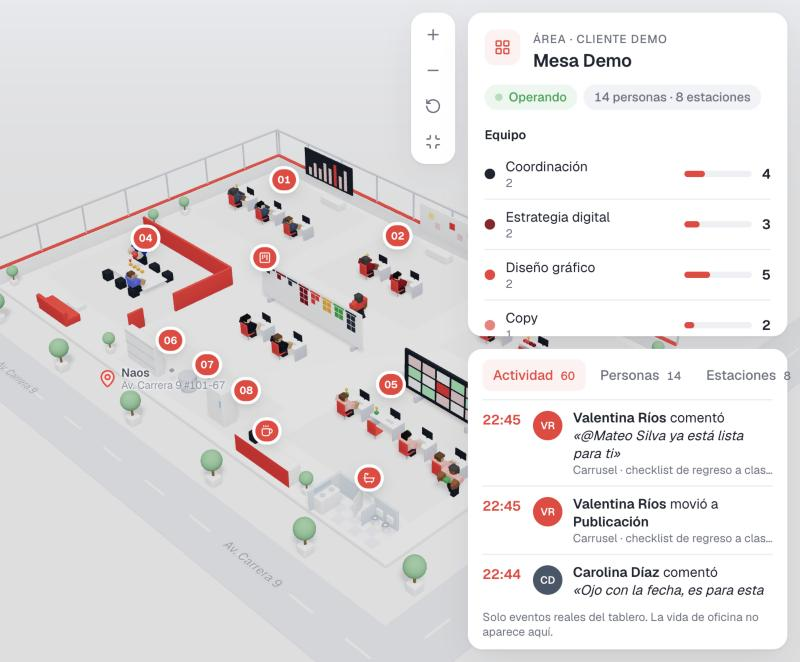
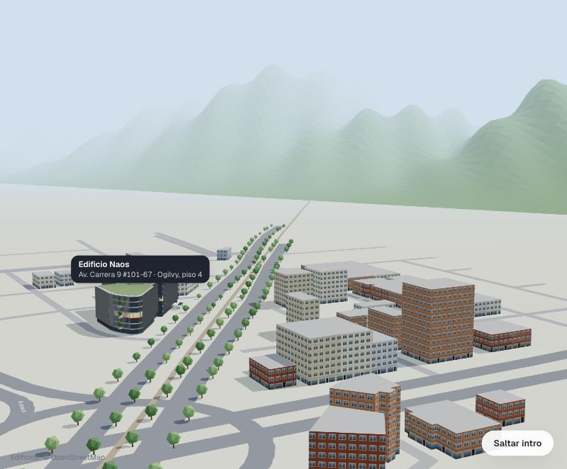
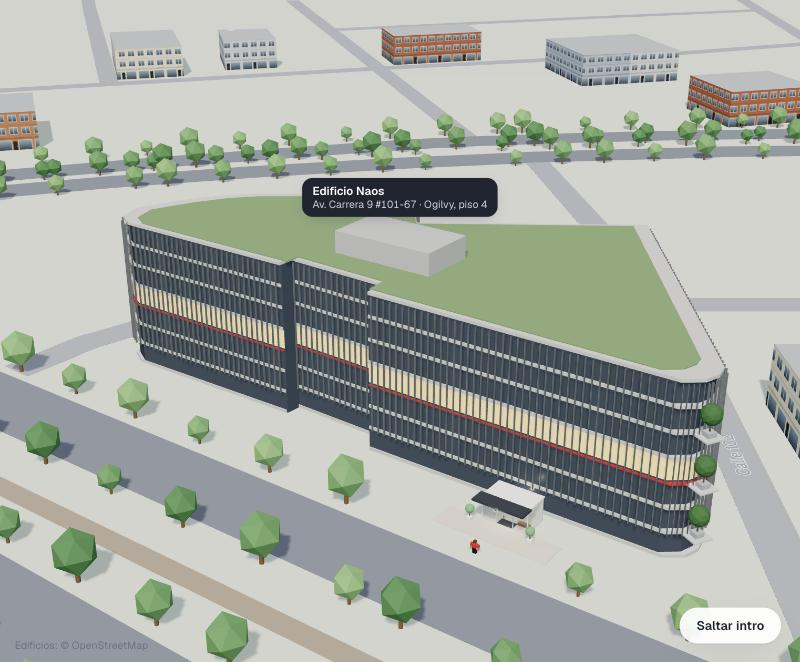
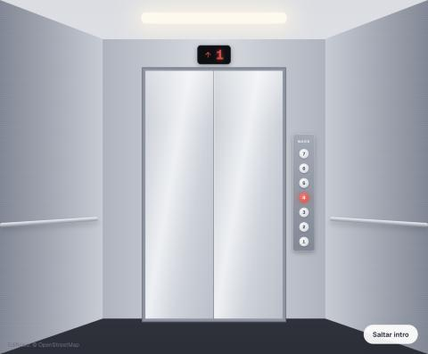
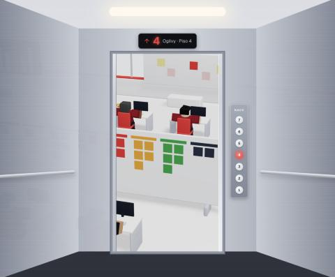
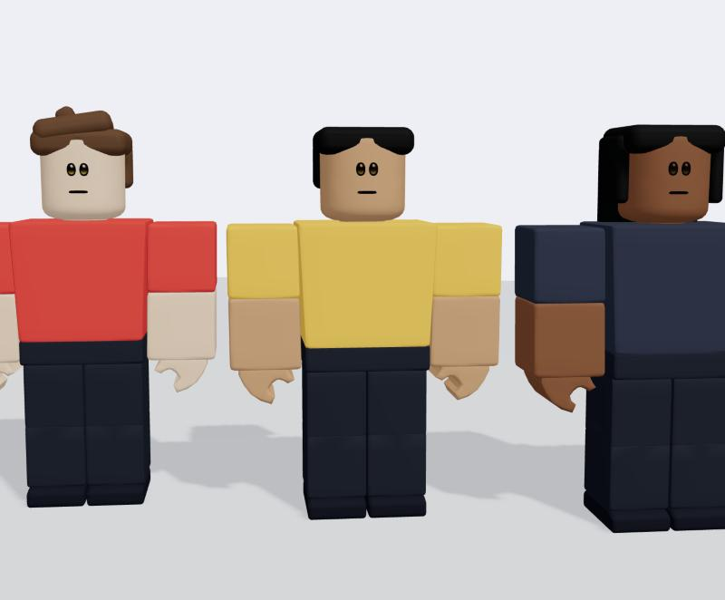
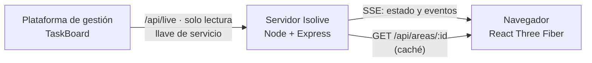

# Isolive

**La operación de un equipo, en vivo, en una oficina 3D.**

Isolive convierte lo que pasa en una plataforma de gestión (tarjetas que se mueven, comentarios, tareas nuevas) en una oficina isométrica animada. Cada persona aparece en su puesto, las piezas de trabajo viajan entre estaciones según la etapa en que están y cada evento real se ve en la escena a los pocos segundos. Está pensada para directivos y clientes que quieren entender de un vistazo cómo va la operación sin entrar a la herramienta de trabajo.

La primera implementación es para **Ogilvy Colombia**: la mesa de Social Media en el piso 4 del edificio Naos, en Bogotá, alimentada por su TaskBoard. Ahí se presenta como *Ogilvy Live*.



| Intro: el barrio real del Naos | El Naos, como el edificio real |
|---|---|
|  |  |

| El ascensor por dentro | Salida a la oficina | Personajes |
|---|---|---|
|  |  |  |

---

## Qué hace

- **Oficina 3D isométrica.** Estaciones por perfil (datos, estrategia, estudio creativo, publicación), puestos, sala de cliente, muro Kanban, pantalla, café, baños, archivo y congelador. Las zonas se marcan con un número que se despliega al pasar el mouse.
- **Personas que trabajan.** Avatares de bloques con caminar, sentarse, teclear, cargar piezas y operar el tablero. La vida de oficina (café, baño, estirarse) es decoración y nunca aparece en el feed ni en las fichas.
- **Piezas que viajan.** Cada tarea es una caja que vive en el puesto de quien la tiene ahora y se mueve a la estación de su etapa. Las vencidas llevan un pin rojo y las urgentes uno ámbar.
- **Quién la tiene.** La pieza va a quien la tiene de verdad, no solo al asignado. El orden es:
  1. la persona mencionada más recientemente en sus comentarios, si su perfil encaja con la estación;
  2. el asignado que encaje;
  3. quien comentó más recientemente y encaje;
  4. si nadie encaja, la bandeja de la estación.

  La ficha explica el motivo.
- **En vivo.** El servidor revisa la plataforma cada 5 segundos y empuja los eventos al navegador por Server-Sent Events. Un comentario aparece como burbuja, una tarjeta movida se ve cargada de un puesto a otro y quien opera el tablero camina al muro Kanban.
- **Fichas.**
  - Área: equipo por perfil y carga.
  - Persona: qué tiene ahora y dónde aparece como responsable.
  - Pieza: recorrido por etapas, quién la tiene y por qué, comentarios recientes.
  - Estación y etapa: quién trabaja en ellas.
- **Tablero completo y vista por etapa.** Un clic en el muro Kanban abre el tablero entero. Un clic en una etapa marca en la escena quién trabaja en ella.
- **Varias áreas.** Un desplegable cambia de área; la elegida queda en la URL (`?area=`). Incluye una **Mesa Demo** con datos inventados y actividad a cualquier hora.
- **Intro cinematográfica.**
  - El barrio real del edificio desde OpenStreetMap, con los cerros orientales al fondo.
  - Una persona entra por el vestíbulo y toma el ascensor; la cabina sube del piso 1 al 4.
  - Al abrir, la cámara sale a la oficina y la interfaz entra escalonada.
  - Se puede saltar, y `?sinintro` la omite.
- **Ver solo la oficina.** Un botón esconde la barra, los indicadores y las etapas, y deja la escena y los paneles de la derecha.
- **Horario laboral.** De lunes a viernes entre 8:00 y 18:00 (hora de Bogotá) la mesa está en sus puestos; fuera de horario, vacía. La Mesa Demo siempre está trabajando.

## Cómo funciona



- **Modelo común** (`web/src/model.ts`): área, persona, pieza, estación, evento y comentario. Cada conector traduce su plataforma a este modelo y la escena solo conoce el modelo. Sumar una plataforma nueva no toca la escena.
- **Un solo camino para los datos.** `aplicar(área, evento)` es lo único que cambia el estado, tanto con eventos reales como con el simulador de prueba. `coreografiar()` convierte cada evento en movimiento: llevar la pieza, ir al Kanban, mostrar una burbuja.
- **Lo real manda, el ambiente decora.** Las órdenes que vienen de eventos reales se atienden antes que la vida de oficina.
- **Solo lectura.** Isolive nunca escribe en la plataforma fuente. Las llaves viven en el servidor (`.env`), nunca en el navegador.
- **Caché en el servidor.** Cada carga de página recibe el estado guardado y no consulta la plataforma, así muchos usuarios a la vez no gastan el límite de consultas.

### El servidor en vivo (`server/src/vivo.ts`)

1. Sondea la actividad de la plataforma cada 5 s.
2. Si hay algo nuevo, trae el estado fresco y empuja por SSE los eventos nuevos y el estado completo.
3. Refresca el estado cada 60 s aunque no haya actividad, para captar reasignaciones y fechas.
4. Manda un *ping* cada 25 s para que los proxies no corten la conexión.
5. Si la plataforma no responde, avisa al navegador, que muestra "Reconectando…".

## Estructura

```
.
├── web/                         Escena y overlay (React + Vite + React Three Fiber)
│   ├── src/model.ts             Modelo común
│   ├── src/areas/               Disposición 3D de cada área y lista del desplegable
│   ├── src/scene/               Oficina, personas, avatar, tráfico, visitantes, piezas
│   ├── src/sim/                 Rutas (Dijkstra), eventos, coreografía, responsable, horario
│   ├── src/intro/               Barrio OSM, vestíbulo, ascensor (cabina)
│   ├── src/ui/Overlay.tsx       Barra, indicadores, fichas, tablero, listas
│   └── public/personajes/       Modelo del avatar (solo demo local, ver Licencias)
├── server/                      Servidor Node 24 + Express 5 (corre el .ts sin compilar)
│   ├── src/taskboard.ts         Conector TaskBoard → modelo común
│   ├── src/vivo.ts              Sondeo, caché y SSE
│   ├── src/index.ts             Rutas /api/areas/:id y /api/areas/:id/eventos
│   └── areas/*.json             Un archivo por área: proyecto, columnas de archivo, persona → perfil y puesto
├── docs/                        Fichas de área, referencias y capturas
└── CLAUDE.md                    Reglas del proyecto para el trabajo con IA
```

## Puesta en marcha

Requisitos: **Node 24 o superior**. El servidor corre TypeScript directo con *type stripping*, `--env-file` y `--watch`.

```bash
cd server && npm install
```

```bash
cd web && npm install
```

Crea `server/.env`. No se versiona y nunca se comparte:

```
PORT=4100
TASKBOARD_URL=https://tu-plataforma.example
TASKBOARD_TOKEN=llave-de-servicio-de-solo-lectura
```

Arranca el servidor y el web en dos terminales:

```bash
cd server && npm run dev
```

```bash
cd web && npm run dev
```

El web queda en `http://localhost:5180` y manda `/api` al servidor en el puerto 4100. Si el servidor no responde, el web cae a **datos de prueba con simulador**: sirve para trabajar la escena sin conexión.

Parámetros útiles en la URL:

| Parámetro | Para qué |
|---|---|
| `?area=mesa-demo` | Abre un área concreta |
| `?sinintro` | Omite la intro |
| `?hora=10:30` · `?dia=3` | Fuerza la hora y el día de Bogotá (1 = lunes) para probar el horario laboral |

### Comandos

| Comando | Qué hace |
|---|---|
| `cd web && npm run dev` | Desarrollo (puerto 5180) |
| `cd web && npm run build` | Chequeo de tipos + build de producción |
| `cd web && npm run check` | Chequeo de rutas y eventos (500 eventos simulados, reglas de "quién la tiene") |
| `cd server && npm run dev` | Servidor en vivo (puerto 4100) |
| `cd server && npm run check` | Chequeo del conector TaskBoard |
| `cd server && npx tsc --noEmit` | Tipos del servidor |

## Agregar un área

1. **Disposición 3D**, en `web/src/areas/`: estaciones (zona, ancla, a qué etapas responden y qué perfiles exigen), puestos y visitas. Se suma a `AREAS` en `web/src/areas/index.ts`.
2. **Configuración del conector**, en `server/areas/<id>.json`:

   ```json
   {
     "id": "mesa-demo",
     "conector": { "tipo": "taskboard", "proyecto": "<id del proyecto>" },
     "archivo": ["Finalizado", "No Aprobado", "Freezing"],
     "personas": [{ "id": "<id de usuario>", "perfil": "social", "puesto": "s1" }]
   }
   ```

   Perfiles: `coordinacion`, `estrategia`, `diseno`, `copy`, `social`, `data`. Un área sin personas no se sirve y el web la muestra con datos de prueba.

## Lo que necesita la plataforma de gestión

Isolive lee tres rutas de solo lectura. En el TaskBoard de Ogilvy viven en el repositorio de la plataforma, no en este:

| Ruta | Devuelve |
|---|---|
| `GET /api/live/projects/:id/state` | Columnas, tarjetas (sin descripciones ni adjuntos), miembros y los últimos 5 comentarios de cada tarjeta |
| `GET /api/live/projects/:id/activity?since=` | Actividad desde una fecha (movida, creada, comentada) |
| `GET /api/live/projects/:id/comments?since=` | Comentarios recortados a 280 caracteres, sin enlaces y con las menciones como ids |

Reglas de esas rutas:
- Llave *Bearer* comparada en tiempo constante.
- Solo los proyectos de una lista permitida.
- Límite de 120 consultas por minuto.
- Sin llave válida responden 404.

### Mesa Demo

Un proyecto real en la plataforma de gestión, con personas y piezas inventadas y sin marcas de clientes. Un **motor demo** dentro de la plataforma genera actividad en ese proyecto a cualquier hora, sin notificaciones:
- cada 20 a 50 s comenta, mueve tarjetas o crea señales nuevas;
- se pasa piezas entre perfiles por asignación o por mención.

Así la demo se ve viva y prueba el camino completo de los datos. Las personas demo son perfiles sin acceso: no pueden iniciar sesión.

## Tecnologías y librerías

**Web**

| Librería | Versión | Uso | Licencia |
|---|---|---|---|
| [React](https://react.dev) + React DOM | 19.2 | Interfaz | MIT |
| [Vite](https://vite.dev) + @vitejs/plugin-react | 8.3 · 6.1 | Desarrollo y build | MIT |
| [TypeScript](https://www.typescriptlang.org) | 6.0 | Tipos (estricto, `erasableSyntaxOnly`) | Apache-2.0 |
| [three.js](https://threejs.org) | 0.186 | Motor 3D (incluye el cargador FBX del avatar) | MIT |
| [@react-three/fiber](https://github.com/pmndrs/react-three-fiber) | 9.8 | three.js con React | MIT |
| [@react-three/drei](https://github.com/pmndrs/drei) | 10.7 | Cámara, controles de mapa, cajas redondeadas, etiquetas HTML en 3D | MIT |
| [lucide-react](https://lucide.dev) | 1.47 | Íconos | ISC |
| [Geist](https://vercel.com/font) (@fontsource-variable/geist) | 5.3 | Tipografía | OFL-1.1 |
| [oxlint](https://oxc.rs) | 1.81 | Lint | MIT |

**Servidor**

| Librería | Versión | Uso | Licencia |
|---|---|---|---|
| [Node.js](https://nodejs.org) | 24+ | Ejecuta TypeScript sin compilar, `--env-file`, `--watch` | MIT |
| [Express](https://expressjs.com) | 5.3 | Rutas HTTP y SSE | MIT |
| [TypeScript](https://www.typescriptlang.org) | 7.0 | Solo chequeo de tipos | Apache-2.0 |

Sin base de datos propia: el estado vive en la plataforma fuente y en la caché del servidor.

## Datos, recursos y licencias

- **Mapa del barrio:** © colaboradores de [OpenStreetMap](https://www.openstreetmap.org/copyright), licencia ODbL. Se extrajo una vez (`web/src/intro/entorno-naos.json`) y la intro muestra el crédito.
- **Edificio Naos:** modelado a partir de fotos y de la descripción pública del proyecto (NAOS Business Campus, Arquitectura en Estudio, 2017).
- **Avatar de bloques:** basado en el modelo de referencia *HipToBeSquare* de los archivos públicos de Roblox ([Roblox/creator-docs](https://github.com/Roblox/creator-docs)). Ese repositorio no declara licencia para sus modelos, así que **solo se usa en la demo local**. Antes de mostrar Isolive a clientes o publicarlo hay que confirmar la licencia o reemplazar el modelo (ver `web/public/personajes/LEEME.txt`).
- **Marca Ogilvy** (logo y rojo `#EF3B3A`): propiedad de Ogilvy, usada solo en su implementación.

## Seguridad y privacidad

- Nunca escribe en las plataformas fuente.
- Las llaves de servicio solo viven en el `.env` del servidor y no se versionan.
- `web/src/mock.ts` tiene solo datos inventados.
- Los comentarios llegan recortados y sin enlaces. Son solo para usuarios internos: el filtro para clientes (sin nombres de personas ni texto de comentarios) se aplica en el servidor y llega con el login.

## Estado y hoja de ruta

- [x] Escena isométrica con datos de prueba y look tipo WareTrack
- [x] Personas, rutas y movimiento; vida de oficina
- [x] Conector TaskBoard con datos reales y regla de "quién la tiene"
- [x] Eventos en vivo por SSE
- [x] Varias áreas y Mesa Demo conectada a la plataforma
- [x] Avatares de bloques, intro con el barrio real, vestíbulo y ascensor
- [ ] Login y roles (interno / cliente) con filtro de privacidad en el servidor
- [ ] Panel de administración: áreas, personas, perfiles y disposición del piso
- [ ] Piso real del edificio con sus fotos (hoy es una oficina genérica)
- [ ] Segunda área: Catálogos (conector a la plataforma de revisión de catálogos)
- [ ] Revisión de rendimiento (el bundle pesa unos 1,3 MB, casi todo three.js), seguridad y despliegue

## Autoría

Idea y dirección: **Imderf Ríos**. Desarrollado con Claude Code.

Repositorio privado. Todos los derechos reservados.
